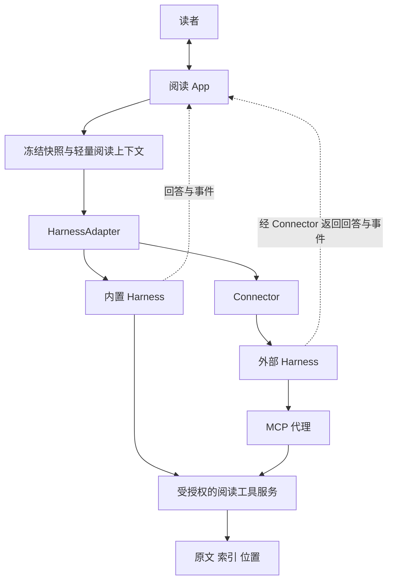

# 开放式 AI 电子书阅读器开发方案

版本：0.3 范围收敛审批稿  
日期：2026 年 10 月 13 日  
支持平台：Windows 11 与 Android  
首要使用设备：Android 平板  
状态：尚未开始产品实现

本稿替代 v0.2。修订重点是学习场景、减少阅读中断、限定平台、缩小工具目录，以及分阶段建设插件系统。所有用户交互继续留在阅读 App 内；内置与外部 harness 作为可替换执行后端。

## 1 产品要解决的问题

**读者遇到不理解的内容时，应能在原文旁获得足够解释，并顺畅继续阅读。** 本项目首先服务这个具体问题。

查资料、复制原文、切换到聊天软件、重新描述背景，再返回书中，会产生额外操作和上下文切换。本项目希望将这条过程缩短为“划线或直接提问 → 在原文旁理解 → 继续阅读”。这是一项待自用验证的产品假设，不预先声称已经证明可以提升学习成绩或养成阅读习惯。

产品定位为：**支持原文旁提问与深入理解的开放阅读器。** 开放模型、可替换 harness 和插件系统服务于阅读目标。首版的优先级依次是阅读顺畅、解释有用、原文可追溯、配置可替换。

阅读媒介本身不足以决定学习深度。设计重点应落在“遇到疑问后如何处理”和“是否真正理解”上。AI 回答也可能带来被动接受，因此默认快速解释，按需提供例子、逐步推导、比较或引导思考；不强制测验，不主动打断读者。

## 2 两个主要使用场景

### 2.1 历史阅读

读者阅读《资治通鉴》到某人被任命为丞相，疑问是“这个时期丞相负责什么”。

App 捕获选文与阅读位置，补入有限上下文和用户问题。默认先解释这个问题；需要背景资料时，harness 可使用已经授权的外部搜索能力。回答必须区分当前书中的记载、外部资料提供的制度背景，以及模型的解释或推断。

古代同名官职可能随时期变化，因此需要建立时间背景。先利用选文、邻近段落与已知章节信息推定；不确定时明确说明并提出一个简短澄清问题，避免因缺少年代而给出泛化答案。书名和所在章节不能被当成对具体年份的可靠替代。

初次回答以直接解惑为主。用户需要时再展开“和另一时期有什么不同”“为什么这件事重要”“查看资料”。拓展内容不自动打开新页面，也不将读者带入无限推荐流。

### 2.2 技术学习

读者阅读深度学习教材，选中梯度下降的描述，并说明“我不懂为什么朝这个方向更新”。

App 附带原句、邻近定义和当前公式。harness 先针对用户具体不懂的地方解释，可使用简单例子、直觉说明与分步推导。公式使用应用内数学排版，读者无需切换到外部聊天软件。

首版保证文本和可解析数学内容的基础路径。若关键公式是图片、扫描页或无法解析的复杂表达，应提示当前上下文缺失，并允许用户补充说明；不把未实现的公式识别或视觉理解包装成已支持能力。

P0 先检查实际准备自用的历史书与技术教材的格式。若主要教材是扫描 PDF 或图片公式，当前 EPUB 首版无法充分验证技术学习场景，应明确调整样本或另行评估格式与视觉能力，不能用普通文字 EPUB 的测试代替。

“换个例子”“从基础解释”“展开推导”“问我一个问题检查理解”等动作由用户主动触发。代码运行、交互实验和自动课程生成后置。

## 3 阅读交互原则

### 3.1 提问与返回

支持选中文字后提问，也支持直接询问当前阅读区域。App 在提问时冻结选区、可见范围及书籍版本；用户随后翻页，当前回答仍围绕原问题。

竖屏采用可调整高度的底部回答面板，横屏和 Windows 大窗口允许侧栏。面板关闭、键盘弹出、屏幕旋转和字号变化后仍保持阅读位置。引用跳转提供返回提问位置的入口。

### 3.2 默认回答

默认先给足以回答问题的简短解释，再按需要提供一个例子或证据。初始长度随问题变化，不强制所有回答使用固定模板。对复杂推导允许适当展开，避免为了“短”而遗漏关键条件。

回答按需展开背景、推导和来源。普通解释以流式文字直接显示，工具执行仅显示简短状态。读者可以展开来源与过程，但无需先看工具清单或执行日志才能读答案。

### 3.3 降低干扰

不因划线自动发送内容，不默认推送练习、推荐资料或学习计划。普通、已授权的只读书内检索不反复确认；扩大数据范围、启用联网或产生写入时，才按实际授权状态处理。

原文中的用户高亮与 AI 临时引用标记保持可区分。AI 可以给出建议笔记，用户点击保存后才成为正式笔记。首版不让 agent 自动改写书籍或批量生成标注。

## 4 平台与首版范围

### 4.1 平台承诺

| 平台 | 项目承诺 |
| --- | --- |
| Windows 11 | 官方支持；纳入构建、安装、核心功能与发布验收 |
| Android | 官方支持；Android 平板触摸阅读为首要体验，纳入真机验收 |
| iOS 与 iPadOS | 无限期挂起，无发布排期与兼容保证 |
| macOS 与 Linux | 无限期挂起，无发布排期与兼容保证 |

其他平台可以自行尝试构建，社区可提交适配，但项目不承诺可编译、可运行或及时修复。不为这些平台建立专门测试矩阵、发布流水线或迁就其差异的产品功能。共享代码保持合理可移植即可。

Android 的最终最低系统及 WebView 版本在 P0 确定，首轮建议用 Android 12 及以上设备验证。Windows 的支持范围为 Windows 11，不承担 Windows 10 及更早版本兼容。

Connector 首版同样以 Windows 11 主机验证。用户可尝试在其他主机系统自托管，但它们没有官方保证；不将“服务器运行模式”暗中扩大成 Linux 的支持承诺。

### 4.2 v0.1 必须交付

| 类别 | 首版范围 |
| --- | --- |
| 阅读 | 无 DRM 可重排 EPUB；导入、基础书架、目录、排版、主题与进度恢复 |
| 标注 | 高亮、书签、用户笔记与导出 |
| 提问 | 划线提问、当前区域提问、流式回答、追问、取消及返回原文 |
| 理解 | 快速解释、翻译、举例和分步说明；公式基础排版 |
| 证据 | 书内搜索、读取片段、引用核验与定位 |
| 模型 | 内置 harness 可配置端点、密钥、模型与提示词；至少两个服务验收 |
| 外部执行 | 一个真实外部 harness，在 Android 与 Windows App 内完成核心问答流程 |
| 插件第一层 | 可安装、启停、导入导出的声明式阅读动作包 |
| 外部知识 | 可选接入一个经验证的搜索来源；无搜索时仍可使用书内问答 |
| 数据 | 本地优先、凭据安全存储、JSON 备份与 Markdown 导出 |

联网搜索可以由内置 harness 的已授权工具提供，也可以由外部 harness 自己的搜索能力提供。明确显示所用来源，不要求两种路径使用同一供应商。自用首版以用户手动导入的 EPUB 为主。

### 4.3 后置事项

多格式兼容、PDF/OCR、书源聚合、自然语言书架管理、第二个外部 harness、自动学习计划、间隔复习、知识图谱、代码执行、云同步、插件市场与付费系统均不作为首版验收项。

外部 harness 仍是首版核心选择之一，不能用“换模型 API”代替真实 harness 接入。首版只验证一个后端，避免同时承诺整个生态。

## 5 技术架构

### 5.1 基线选型

| 层次 | 选择 |
| --- | --- |
| 应用容器 | Tauri 2，仅对 Windows 11 与 Android 形成产品支持承诺 |
| 界面 | React、TypeScript、Vite，响应式阅读面板 |
| 阅读引擎 | foliate-js，固定提交并封装 ReaderAdapter |
| 原生服务 | Rust、Tokio，管理文件、凭据、网络、权限和数据库 |
| 存储 | SQLite，通过 Rust 访问；结构化数据与可重建全文索引 |
| 检索 | FTS5、中文预分词和短词受限扫描兜底 |
| 数学排版 | 打包 KaTeX，限制不可信 HTML 与危险宏能力，经过公式样本验收 |
| MCP | 官方 Rust SDK rmcp，固定版本并验证与目标 harness 互操作 |
| 默认执行 | TypeScript 最小 harness，通过同一工具服务取证 |
| 外部执行 | HarnessAdapter；优先验证 Hermes ACP 路径 |
| 连接服务 | TypeScript Connector，Windows 11 主机验证 |

foliate-js 尚未承诺稳定 API，其 PDF 适配为实验性质；首版 EPUB 范围与固定提交策略据此确定。[foliate-js 项目说明](https://github.com/johnfactotum/foliate-js)

KaTeX 用于 AI 回答中的数学表达，不替代 EPUB 原有公式的解析或识别。对不可信输入禁用 trust，限制 maxExpand 与 maxSize，并清理输出及错误显示，避免公式输出绕过 Markdown 的内容限制。[KaTeX 安全选项](https://katex.org/docs/security)

### 5.2 边界



App 管理原文、位置、交互、证据与权限。harness 管理模型、执行循环及自身记忆、技能、插件。App 到 harness 的执行接口，和 harness 调用 App 工具的 MCP 接口，保持职责独立。

一次任务只由一个选定 harness 执行，App 不在外部 harness 之外再运行一个 LLM 调度循环。默认阅读上下文直接随任务发送，减少为了获取当前位置而额外调用工具。

原生网络层仅控制本 App 发出的请求；外部 harness 自己的网络、Shell 和插件不自动受它控制。后端能力与权限边界必须如实展示。

## 6 收敛后的工具契约

### 6.1 工具服务于按需取证

此前把元数据、目录、选区、界面展示、追问和书架操作一并列为工具，范围偏大。对于当前学习场景，App 已经知道用户正在读什么，应把必要信息一次随问题送出。

首版默认只向 harness 暴露两个核心书内工具：

| 工具 | 输入示意 | 职责 |
| --- | --- | --- |
| book_search | query、maxResults、cursor | 在本次授权书籍和阅读边界内查找证据 |
| book_read_passage | ref、direction、paragraphs、maxChars | 读取指定片段或有限邻近段落 |

book_search 默认最多返回 5 条结果。book_read_passage 的 ref 由 App 在初始上下文或搜索结果中签发；它不是任意文件路径或 URL。direction 可为 around、before、after，默认读取范围及硬上限由宿主控制。

书籍、书籍版本、快照、调用身份与 runId 绑定在宿主授权记录中，不能由模型修改参数来换书或扩大权限。需要跨书检索时，未来通过单独授权的扩展工具增加，不让当前工具默认搜索整个书架。

外部知识检索不是这两个书内工具的变体。它属于独立的来源适配器或 harness 工具，使用单独网络授权并返回外部来源信息。

### 6.2 哪些交互无需工具化

用户问题、选文、必要元数据和快照随执行请求提供。普通回答、流式状态、澄清问题、确认和取消使用会话执行事件。引用展示和用户点击跳转由 App 完成。

首版不默认暴露 library_search、book_open、annotation_create、reader_navigate、ui_present_choices 或通用 UI 渲染工具。它们可以在出现真实使用场景后作为受权限控制的扩展加入。

MCP 负责开放能力，但并不规定特定的用户交互模式；工具名称、参数与 Schema 应反映实际能力。[MCP Tools 规范](https://modelcontextprotocol.io/specification/2026-07-28/server/tools)

### 6.3 保留必要契约

“做减法”不等于删除契约。必须明确四件事：工具接受什么、实际读取哪个范围、返回的证据如何定位、失败如何解释。

工具输出采用以下应用级结构，MCP 的外层报文由 SDK 处理：

```json
{
  "schemaVersion": 1,
  "snapshotId": "snap_01",
  "bookVersion": "sha256:…",
  "fragments": [
    {
      "citationId": "cite_01",
      "ref": "passage_01",
      "text": "从书中实际提取的原文",
      "label": "第三章 某节",
      "anchorRef": "anchor_01"
    }
  ],
  "truncated": false,
  "nextCursor": null,
  "indexStatus": "ready"
}
```

ref 与 anchorRef 是 App 管理的不透明引用，权限检查仍在原生服务执行。实际 CFI、文本引用选择器和 DOM 映射由 App 保存，避免模型必须生成复杂定位表达式。

历史版本、权限撤销、读取边界、索引未完成、引用失效和超时使用稳定错误类别。索引未完成不等于整本书无结果；返回完成度或可用范围，避免误导回答。

引用展示前核验 citationId 来自本次初始资料或真实工具结果，并检查引用文字。文字匹配与定位成功只证明证据来源，不保证解释正确。模型无证据的背景解释不得伪造“书中引用”。

### 6.4 契约何时稳定

目前没有已经发布的客户端，因此可以在 P0 和个人试用期间修改工具设计。先实现两个工具并验证历史、技术阅读，再形成公开的 v1 契约；不提前承诺永久兼容。

公开后使用 JSON Schema、schemaVersion、变更记录和兼容测试。插件工具采用独立命名空间，例如 plugin_glossary_lookup，避免与核心工具冲突。内置调用、MCP 和插件调用复用同一权限服务。

协议目标仍为 MCP 2026-07-28，并验证目标 harness 所需的 2025-11-25 兼容路径。具体版本行为交给固定 SDK 版本及互操作测试，不自行混用协议生命周期。[MCP 版本与兼容规范](https://modelcontextprotocol.io/specification/2026-07-28/basic/versioning)

## 7 插件系统的阶段安排

### 7.1 区分三类扩展

| 扩展 | 属于谁 | 解决什么 |
| --- | --- | --- |
| 阅读器插件 | 本项目 | 阅读动作、知识来源、词典、模型与 harness 适配、受限界面扩展 |
| harness 插件或技能 | 所选执行后端 | 其记忆、规划、学习、搜索和工具组合 |
| Tauri 原生插件 | 开发实现 | Android 或 Windows 的系统能力桥接 |

三者不共用同一安装机制。使用 Tauri 插件并不意味着产品已经有面向读者的插件系统；支持某个 harness 也不意味着它的插件自动能在 Android App 内执行。Tauri 官方插件由 Rust 及可选前端和移动原生部分组成，属于实现层。[Tauri 插件开发说明](https://v2.tauri.app/develop/plugins/)

### 7.2 P0 与架构阶段

现在就定义四个内部扩展边界：ReadingAction、ProviderAdapter、HarnessAdapter、KnowledgeSource。采用清楚的注册、调用和停用接口，核心阅读与权限模块不依赖特定供应商。

这些是内部模块接口，允许在试用中演进。此阶段不建设插件市场、通用脚本运行时或复杂依赖系统，也不要求把基础排版、书架和数据库全部拆成插件。

### 7.3 v0.1 声明式阅读动作包

首版交付一个真正可安装、启停和导出的轻量插件层，支持提示词、快捷动作、回答偏好及受限的上下文偏好。例如历史释义包、技术概念解释包、翻译包。

声明式插件由宿主解释配置，不执行任意 JavaScript，不直接访问文件、网络或密钥。插件声明的上下文偏好只能在已有用户授权内生效；安装包不能自动启用联网或扩大书籍读取范围。

示例清单如下，正式字段在实现时用 Schema 定义：

```json
{
  "manifestVersion": 1,
  "id": "org.example.history-reading",
  "version": "0.1.0",
  "type": "reading-action-pack",
  "name": "历史阅读释义",
  "hostApi": "1",
  "actions": [
    {
      "id": "explain-office",
      "label": "解释这个官职",
      "appliesTo": ["selection", "viewport"],
      "promptTemplate": "结合当前段落的时期解释这个官职。不确定年代时说明；区分原文与外部背景。"
    }
  ]
}
```

App 完成 Schema 校验、安装预览、动作注册、启停、升级和卸载。模板变量仅来自宿主提供的安全字段，不能执行表达式或命令。配置变化可回滚，升级同一 ID 时需可信的包身份或明确确认，不能仅凭名称覆盖。

用户删除动作包不删除自己已保存的笔记和问答。它首先满足“分享自己的阅读助手配置”，无需先承担任意代码扩展的风险与维护成本。

### 7.4 v0.2 可执行插件

在 Windows 与 Android 的核心阅读流程稳定、至少两个真实扩展需求验证后，再建设公开 SDK 与可执行插件宿主。候选首批扩展是本地词典或术语表、可配置知识来源、第二个 harness 适配器。

公开插件宿主至少需要：manifest、宿主 API 版本、加载与卸载、权限声明及撤销、资源配额、取消、错误隔离、崩溃停用、升级与兼容测试。运行时选择必须经过两平台验证，不预先承诺任意 npm 包、Python 包或原生二进制均可运行。

原则是通过有限的 Host API 访问选文、来源检索和受限结果组件。网络与文件访问经过权限服务；不把原始数据库、模型密钥、任意 DOM 或通用原生调用交给插件。沙箱方案尚未选定，在证明隔离前不发布第三方代码执行能力。

首批可执行扩展应优先验证 Win11 与 Android 共用的 API。确需平台特有能力时在 manifest 显式标注，App 显示不支持；不以“插件已安装”暗示功能在两端都可用。

### 7.5 市场与生态

初期通过文件或仓库分发动作包。签名分发、审核、依赖解析、市场、收费和复杂 UI 插件在出现实际用户需求后另行决定，没有固定发布日期。

插件系统分阶段的依据是成本与真实扩展需求，而不是等所有功能完成才考虑扩展。首版内部边界与动作包已经为后续保留空间。

## 8 上下文 证据与定位

### 8.1 初始阅读任务包

包含用户问题、冻结快照、选文或可见段落、有限邻近正文、必要的章节及书籍信息、允许读取的范围和可用工具。对外部 harness，不覆盖其已有身份、记忆和技能选择策略。

历史问题可能需要时间信息，技术问题可能需要邻近定义或公式。先从许可范围内提取已有信息；不足时澄清或按需取证，不静默读取整章或全书。普通解释可以直接回答，无需每次都搜索。

### 8.2 初始预算

内置后端默认正文目标为 1,500–3,000 tokens，按完整段落组织。单次读取默认约 2,000 tokens，单轮新增正文默认最多约 6,000 tokens，工具调用默认最多 6 次。根据模型容量预留输出、工具描述、历史和安全余量，不能把预算直接相加后塞给任意模型。

工具暴露的 maxChars 是请求偏好，实际受宿主字符数、估算 token、权限和累计输出上限共同限制。外部 harness 的内部总步数与费用，只有其接口支持时才能控制；App 始终可以限制自身提供的正文量。

### 8.3 原文定位

使用书籍版本、资源路径、spine 顺序、CFI 和文本 exact/prefix/suffix 的复合 Locator。视觉页码仅用于显示，不作为稳定位置。

资源清理、渲染和正文提取使用一致、带版本的变换流程；保留文本节点到规范化文字的偏移映射。明确 UTF-16、字符或字节偏移单位，测试中文、emoji 和组合字符。定位有多个候选时提示失效或选择，不静默跳到相似句子。

### 8.4 内容范围与隐私

保留截至提问位置、当前章节、全书三种读取范围；默认使用截至提问位置的范围，用户可为书籍和会话调整。该限制同步用于正文、检索摘要、目录和历史摘要。切换到更窄范围时重新构建安全历史。

这只限制 App 提供的资料，不能保证模型或外部 harness 的既有记忆不含后文。需要外部背景时可单独授权搜索，明确其数据流向及剧透边界。

首次连接服务及范围变化时提供发送预览。已有授权内的正常书内读取不反复弹窗。外部服务收到内容后可能保存，撤销连接不能收回已经发送的资料。

## 9 Harness 接入与运行

### 9.1 首个后端

优先验证 Hermes ACP。官方说明该接口允许其他宿主承接对话，并保留 Hermes 的身份、配置、记忆、技能和工具；具体可用范围仍需固定版本实测。[Hermes ACP 宿主接口](https://hermes-agent.nousresearch.com/docs/user-guide/features/acp)

首版验证核心问答、会话映射、技能和记忆按配置加载、阅读工具调用、澄清和取消。自增长的完整效果、自动调度和所有插件覆盖不作为首版硬指标，也不据接入名称宣称全部保留。DeepSeek Harness 等后端作为第二适配对象后置。

### 9.2 执行契约

HarnessAdapter 管理能力探测、会话打开、提交问题、订阅运行事件、回应交互及取消。事件携带 runId、sessionRef、eventId 和序号，避免重连后重复显示或跨书串线。

App 保存用户可见消息和证据；harness 保存其执行状态和记忆。二者通过会话映射关联。切换 harness 时可新建会话或发送经预览的对话摘要，不承诺无损迁移后端隐式记忆及插件环境。

临时、按书或个人记忆范围只有后端能够真实兑现时才显示为保证。单纯在提示词中写“不保存”不等于隔离或删除。

### 9.3 Connector

Android 和 Windows App 主动连接经过配对的 Windows 11 Connector。Connector 对接 harness 的执行入口，并提供 MCP 代理；工具请求回到设备端权限服务，绑定调用身份、设备、运行与快照。

正式连接使用经过验证的 TLS 配置；凭据与回调授权分别管理。局域网开发调试可以使用明确标记的 HTTP 例外，不作为公网部署默认值。Connector 可能看到转发内容，不据 TLS 声称其无法读取。

设备离线时返回不可用，不假装持有实时阅读位置。取消后先撤销该运行的新工具访问，再通知后端；未收到确认时说明后端停止待确认。事件重放不重放写入。

首版以 App 前台使用为基线，不承担安卓长期后台运行。Windows 本机执行可复用相同适配边界；直接启动本地进程的便利功能不阻塞首版核心问答。

## 10 数据 安全与开源

保存原始书籍、书籍版本、正文块及映射、阅读状态、快照、笔记、对话、运行、证据、后端连接、插件清单和权限记录。SQLite 索引可重建；笔记和会话作为用户数据保护。

模型密钥和连接凭据存放于平台安全存储或经验证的加密凭据库，数据库仅保存引用，不写入明文 localStorage、诊断日志或默认导出。外部 harness 默认使用自己管理的模型凭据。

备份提供版本化 JSON，笔记与问答提供 Markdown。原书可选包含，密钥默认不包含。导入按书籍哈希核对版本；升级前备份，失败可恢复。卸载插件与删除用户数据分别处理。

EPUB 和 AI Markdown 均视为不可信内容。阅读内容使用无通用原生权限的宿主、资源清理与 CSP，默认禁止书籍脚本及自动外网资源请求。不能依赖一个 iframe 就假定 Android 原生桥已经隔离。[foliate-js 安全说明](https://github.com/johnfactotum/foliate-js#security)、[Tauri 权限边界](https://v2.tauri.app/security/capabilities/)

导入检查 ZIP 路径穿越、展开规模、资源数量和解析超时。AI Markdown 禁用原始 HTML 与远程图片自动加载。书籍、网页和插件描述中的指令不能覆盖宿主权限。

建议自研客户端、核心、默认 harness、HarnessAdapter、Connector、插件接口和示例采用 Apache-2.0，并保留 foliate-js 等依赖各自许可。harness 本身按其原许可使用，不将它们重新标为本项目许可。离线阅读与自配模型不依赖官方账号或强制订阅。[foliate-js MIT 许可](https://github.com/johnfactotum/foliate-js/blob/main/LICENSE)

## 11 开发顺序

| 阶段 | 重点 | 进入下一阶段的条件 |
| --- | --- | --- |
| P0 技术验证 | Android 选区与定位、Win11 容器、内容隔离、真实 harness 双向路径 | 关键风险有运行证据，不只看文档 |
| P1 阅读原型 | 两端 EPUB 阅读与划线交互、直接提问入口、位置保持 | 发起人愿意连续阅读，操作不频繁出错 |
| P2 学习问答 | 上下文、两个工具、内置后端、解释与引用 | 历史及技术阅读均能在原文旁解惑 |
| P3 开放接入 | 首个外部 harness 产品化、声明式动作包、模型与配置导出 | 两平台完整问答与动作包生命周期通过 |
| P4 自用发布 | 故障、恢复、迁移、性能、安全与开源文档 | 连续自用验证及核心验收通过 |
| 后续插件阶段 | 第二个后端及真实来源扩展，再建设公开可执行 SDK | 两个实际扩展需求明确，两平台隔离可验证 |

P0 暂估 2–3 人周。前版 14–21 人周总估算不直接作为本稿承诺：平台减少、Win11 正式验收和插件分层会同时改变工作量。P0 后按实际适配与隔离成本重估首版，不以删掉平台名称直接推导工期按比例减少。

P1–P2 可较早开始个人阅读试用；外部 harness 和动作包仍需在首版发布前交付。可执行插件不占用首版关键路径。

## 12 验收与产品假设验证

### 12.1 必须通过的技术验收

- Win11 与 Android 均可安装、导入 EPUB、离线阅读、恢复位置及导出用户数据。
- Android 连续 50 次选字及调整选区不误翻页；屏幕旋转、面板和键盘变化不丢失位置。
- 提问后翻页或切书，回答仍绑定原快照；测试原文引用均正确定位和核验，失效时明确提示。
- 核心工具拒绝越权、过期引用及超范围读取；中文短词与索引未完成状态有可解释结果。
- 内置后端通过两个模型服务测试，外部后端通过一个真实 harness 的问答、工具、追问及取消测试。
- 插件包可安装、启停、升级和卸载；导入不扩大授权、不执行代码、不删除用户笔记。
- 断网、超时、限流、后端失败、重连及取消不会冻结阅读器或产生重复副作用。
- 恶意书籍和 AI Markdown 无法执行脚本、调用原生桥或自动向外发送内容。

### 12.2 学习场景验收

以获许可的历史和技术书籍建立问题集。历史类关注年代背景、官职或人物关系、书内记载与外部材料区分；技术类关注定义、符号、前置概念、直觉和推导。

观察解释是否回答读者具体的不懂之处，是否出现无依据的引文，以及读者是否需要重复描述 App 已知的上下文。核验来源和定位，不以“有引用”替代对答案内容的审阅。

### 12.3 自用观察

建议连续一周自用并手动记录少量实际疑问，比较原先切换外部 AI 的流程与 App 内流程：

| 观察项 | 用途 |
| --- | --- |
| 为解决一个问题需要切换多少次应用 | 判断是否减少离开原文的操作 |
| 从发问到能继续阅读的大致时间 | 判断解释是否及时且足够 |
| 是否仍需重复复制原文和说明背景 | 判断上下文构建是否有效 |
| 读者能否用自己的话解释刚才的概念 | 辅助判断理解，而非强制测验 |
| 是否经常被过长回答或推荐分散注意 | 判断 AI 是否制造了新的干扰 |

这些是探索性观察，不是学习效果的科学证明。不把聊天时长、提问次数或用户停留时长作为首要成功指标。指标默认由用户主动记录；遥测默认关闭。

## 13 本次审批项

- [ ] 产品以原文旁解惑和顺畅继续阅读为核心，快速解释默认，深入学习按需展开。
- [ ] 仅正式支持 Windows 11 与 Android；Apple 与 Linux 等无限期挂起，自行构建不提供保证。
- [ ] 首版保留内置 harness 与一个真实外部 harness，用户交互始终在 App 内。
- [ ] 首版核心工具收敛为书内搜索与读取片段，其他操作按真实需求后置。
- [ ] 现在预留扩展边界，首版交付声明式动作包，阅读流程稳定后建设可执行插件 SDK。
- [ ] 先做 P0 并重估工期，自研核心与插件接口保持开源，未开始产品实现。

审批意见：________________  
需修改事项：________________  
批准进入阶段：________________

## 14 证据范围

本稿参考上文链接的项目及官方协议文档，核对日期为 2026 年 10 月 13 日。产品交互、工具收敛和插件阶段安排属于针对当前目标的工程建议。

尚未执行：Win11 或 Android 产品构建、foliate-js 指定提交测试、内容隔离验证、Hermes 适配、Connector、模型请求、插件宿主、定位及性能测量。可执行插件的隔离运行时未选定；不得将其描述为已经设计验证完成。
